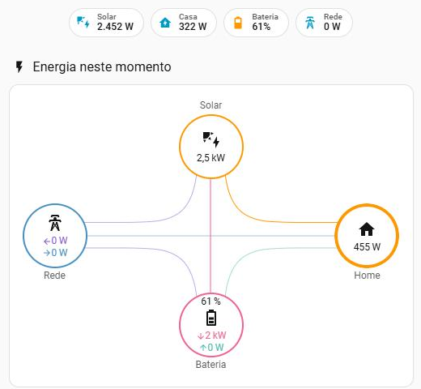
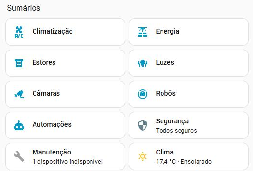
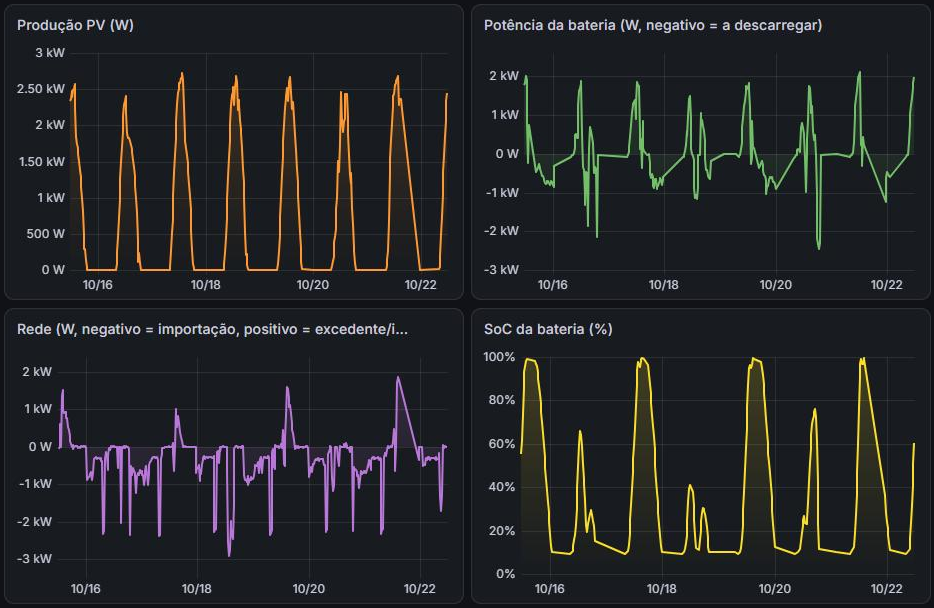
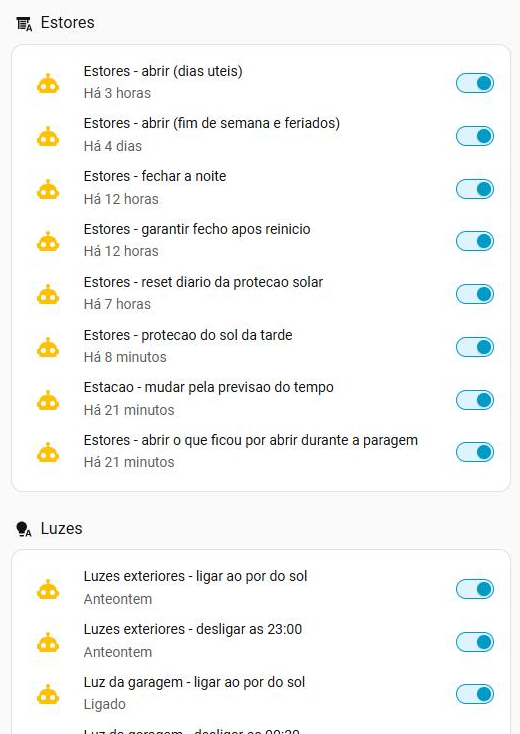
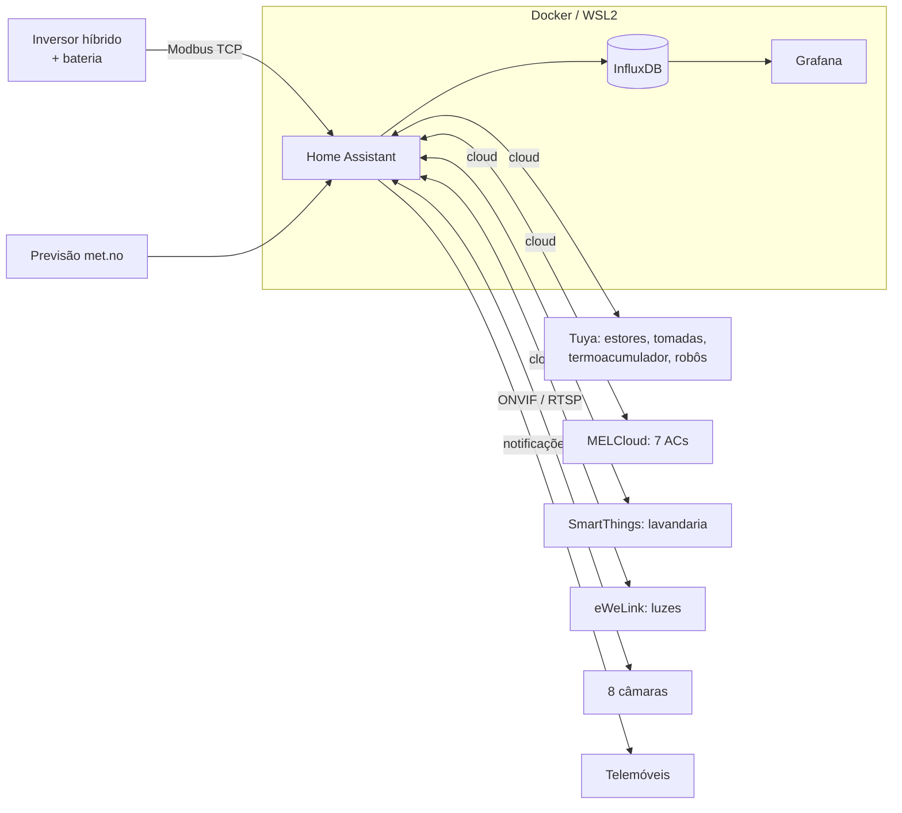

# Casa inteligente com gestão de excedente solar

> Sistema de domótica e gestão de energia para uma moradia com painéis
> solares e bateria, construído com **Home Assistant**, **Docker**,
> **Modbus TCP**, **InfluxDB** e **Grafana**.
>
> *Smart-home and solar-surplus management system for a house with PV panels
> and a battery: Home Assistant, Docker, Modbus TCP, InfluxDB, Grafana.*

<p align="center">
  
  
</p>

## O problema

A casa tem um inversor híbrido de 3,7 kW com bateria. A análise de dados
mostrou que **compra ~11 kWh/dia à rede e só injeta ~2 kWh/dia**. O excedente
solar é curto e concentra-se ao início da tarde, quando a bateria enche.
A casa tinha ainda 50+ aparelhos espalhados por 5 apps diferentes
(Tuya/Smart Life, Mitsubishi MELCloud, Samsung SmartThings, eWeLink, Tapo).

## O que foi construído

| Área | Resultado |
|---|---|
| **Monitorização de energia** | Leitura do inversor por Modbus TCP a cada 5 s; histórico em InfluxDB; painéis em Grafana e no HA (fluxo solar → bateria → casa → rede em tempo real) |
| **Excedente solar** | Termoacumulador (~2 kW) deslocado para a janela solar: liga com bateria cheia + excedente, desliga se a bateria descarregar ou se a casa começar a comprar à rede; bloco da manhã, apoio ao fim da tarde, ciclo anti-legionella |
| **13 estores** | Horário por dias úteis / fim de semana / feriados; fecho 30 min depois do pôr do sol; proteção do sol da tarde na fachada poente (azimute + elevação do sol + produção solar real + temperatura da divisão); **estação Verão/Inverno automática pela previsão meteorológica**; modo cinema |
| **Integração da casa** | 50+ aparelhos de 5 ecossistemas num só painel, organizado por pisos e divisões; 8 câmaras com vídeo ao vivo e rotação (ONVIF) |
| **Conforto** | AC do quarto desliga-se sozinho à noite (temperatura alvo ou tempo máximo), com notificação acionável "+30 min" |
| **Avisos** | Roupa pronta, "há sol a sobrar para lavar", resumo diário de energia, casa vazia com aparelhos ligados (botão "desligar tudo"), aparelhos offline |
| **Fiabilidade** | Recuperação automática da ligação ao inversor, novas tentativas isoladas quando a cloud Tuya falha, recuperação das ações perdidas após uma paragem, servidor Windows preparado para correr 24/7 |

<p align="center">
  
  <br><sub>Últimos 7 dias no Grafana: produção solar, bateria, rede e carga da bateria.</sub>
</p>

<details>
<summary><b>Ver todas as automações (captura)</b></summary>
<p align="center"></p>
</details>

## Arquitetura



Mais detalhe em [docs/arquitetura.md](docs/arquitetura.md).

## Destaques técnicos

- **Diagnóstico por dados antes de automatizar**: 15 dias de recolha
  mostraram que a ideia inicial ("ligar cargas quando sobram 2 kW") quase
  nunca disparava; a estratégia passou a ser *deslocar consumo para a janela
  solar*, tendo em conta que o inversor cobre défices com a bateria antes de
  importar.
- **Engenharia reversa de dispositivos**: estores Tuya reportavam a posição
  invertida e, em alguns, os comandos trocados. Foi resolvido com *template
  covers* e testes estore a estore; ligação local (protocolo Tuya v3.3) a um
  dispositivo não suportado, com descoberta por broadcast UDP decifrado.
- **Robustez contra falhas reais**: erros intermitentes da cloud Tuya
  ("sign invalid") paravam scripts inteiros → cada comando passou a correr
  isolado, com confirmação e repetição; o dongle do inversor ficava preso a
  uma ligação "fantasma" após reinícios → recarga automática + aviso.
- **Tudo parametrizado**: limiares e horários editáveis no painel, sem tocar
  em código.

As lições e incidentes reais estão em
[docs/licoes-aprendidas.md](docs/licoes-aprendidas.md).

## Estrutura

```
homeassistant/packages/   automações e ajudantes (YAML + Jinja2)
scripts/                  diagnóstico: Modbus, descoberta Tuya, eventos do Windows
grafana/                  painel Grafana (JSON)
docs/                     arquitetura, plano dos estores, lições aprendidas
docker-compose.example.yml
```

## Tecnologias

Home Assistant · Docker / WSL2 · Python (pymodbus, tinytuya) · PowerShell ·
Modbus TCP · protocolo local Tuya · ONVIF / RTSP · InfluxDB 2 (Flux) ·
Grafana · YAML / Jinja2 · redes TCP/IP (DHCP, ARP, mesh Wi-Fi)

## Nota

Projeto pessoal desenvolvido com o apoio do **Claude Code** (assistente de
IA) para a escrita de configuração e scripts; o levantamento da casa, as
decisões, os testes no terreno e a operação diária são do autor. Dados
pessoais (nomes, endereços, IPs, identificadores) foram removidos ou
substituídos.
